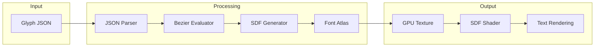
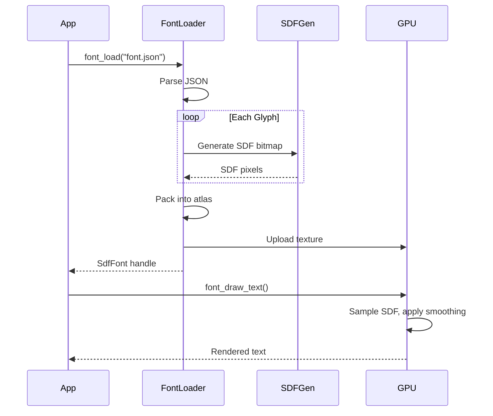

# SDF Font Renderer from Scratch

## Architecture Overview



## File Structure

```
raylib-usecase/
├── main.c              # Demo application
├── font_sdf.h          # SDF font renderer (single header)
├── font_sdf_shader.h   # GLSL shaders as strings
├── nob.c               # Build script
└── Vollkorn-Regular.ascii32-126.glyphs.json
```

## Implementation Components

### 1. JSON Parser (~150 lines)
Minimal JSON parser for the glyph format:
- Parse font metrics (unitsPerEm, ascender, descender)
- Extract glyph data (advanceWidth, leftSideBearing)
- Parse contours with M/Q/L/Z commands

### 2. Bezier Mathematics (~100 lines)
- `bezier_quadratic_point(t, p0, p1, p2)` - Evaluate point on curve
- `bezier_quadratic_distance(point, p0, p1, p2)` - Distance from point to curve
- `point_in_polygon(point, contours)` - Winding number test for inside/outside

### 3. SDF Generator (~200 lines)
For each glyph:
1. Create a bitmap (e.g., 64x64 pixels with padding)
2. For each pixel, compute signed distance to nearest contour
3. Positive = outside glyph, Negative = inside glyph
4. Normalize to 0-255 range (128 = on edge)

```c
for each pixel (x, y):
    min_dist = INFINITY
    for each contour segment:
        dist = distance_to_bezier(pixel, segment)
        min_dist = min(min_dist, dist)
    
    sign = point_inside_glyph(pixel) ? -1 : +1
    sdf[y][x] = 128 + sign * min_dist * scale
```

### 4. Font Atlas Packer (~100 lines)
- Pack all glyph SDFs into single texture (e.g., 512x512)
- Store UV coordinates for each glyph
- Use simple row-based packing

### 5. SDF Shader (~50 lines GLSL)
Fragment shader for smooth text rendering:

```glsl
float dist = texture(sdfTexture, uv).r;
float edge = 0.5;
float smoothing = fwidth(dist) * 0.5;
float alpha = smoothstep(edge - smoothing, edge + smoothing, dist);
```

### 6. Text Rendering API (~150 lines)
```c
SdfFont font_load(const char *json_path);
void font_draw_text(SdfFont *font, const char *text, float x, float y, float size, Color color);
void font_unload(SdfFont *font);
```

## Key Data Structures

```c
typedef struct {
    float x, y;
} Vec2;

typedef struct {
    char cmd;           // 'M', 'Q', 'L', 'Z'
    Vec2 control;       // For Q commands
    Vec2 to;            // Endpoint
} PathCmd;

typedef struct {
    int codepoint;
    float advanceWidth;
    float leftSideBearing;
    PathCmd *commands;
    int command_count;
    // SDF data
    Rectangle atlasRect; // UV in atlas
} Glyph;

typedef struct {
    Glyph glyphs[128];
    Texture2D atlas;
    Shader sdfShader;
    float unitsPerEm;
    float ascender;
    float descender;
} SdfFont;
```

## Rendering Pipeline



## Build Updates

Update [nob.c](nob.c) to compile the new files (no changes needed if single-header).

## Demo Application

The main.c will demonstrate:
- Loading the font
- Rendering text at various sizes (SDF scales smoothly)
- Optional: outline effect, drop shadow using SDF
